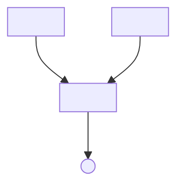

# <Topic>

*Serves: <a wikilink to each track> · <…>*

## Probe

<The probe quizzes (`Quiz — probe`) and the learner's results, written here as they happen. The Goal and Plan below are added once Probe is done.>

> [!abstract] Goal
> <What the learner wants to be able to do or explain at the end, in one or two sentences.>

## Plan

<Approach in a few sentences: where their edge is, what we build from, why this order.>

- [ ] 1. <step>
- [ ] 2. <step>
- [ ] 3. <step>

## 1. <Step name>

> [!question] Quiz — predict
> <The problem this step solves, pointed at before it's taught — no answer or hint here.>
>
> 1. <option>
> 2. <option>
> 3. <option>

> [!info] Prediction — missed
> Your answer: <n>. <label>
> Confidence: <guess|unsure|sure>
> Correct answer: <n>
> Note: <their reasoning, if given>
>
> <One line; the teaching below resolves it.>

<From their attempt: what held, where it broke → the problem → the mechanism → what follows → where it stops holding. Diagram, worked numbers, analogy as needed.>

> [!question] Quiz — check
> <A new case that applies the step — answerable from the session, no answer or hint here.>
>
> 1. <option>
> 2. <option>
> 3. <option>

> [!success] Quiz — correct ✓
> Your answer: <n>. <label>
> Confidence: <guess|unsure|sure>
> Correct answer: <n>
> Note: <their reasoning, if given>
>
> <Why the right answer is right; what the error in the other picks would be.>

## Recap

<In their words: the 2–4 ideas the steps hang on.>

## Open questions

- <Raised but not resolved; adjacent topics for future lessons.>

## Sources

- [<Title>](<url>) — <what it verified>
