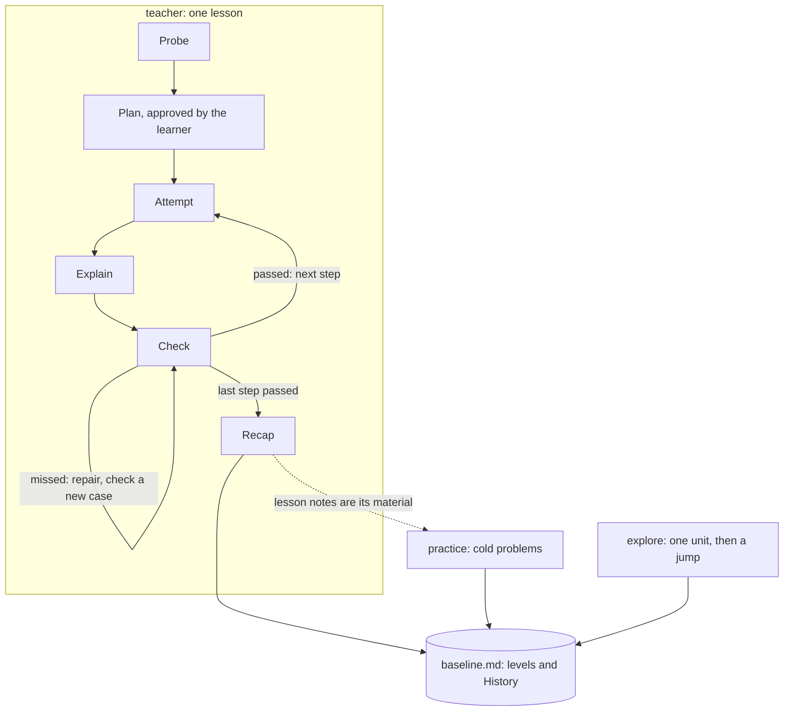

# teach-loop

Four Claude Code skills (`teacher`, `practice`, `explore`, `debrief`) and one subagent (`researcher`) that teach, retest and track a learner inside an Obsidian vault. Every lesson, practice problem and exploration unit is written live into a Markdown note, and levels with their dated evidence live in `baseline.md` and a graph of skill nodes, so the learner's record is a folder of plain files under git. It fits one learner per clone, who fills in `LEARNER.md` and runs Claude Code from the vault folder.

Two meanings of "skill" appear below: the Claude Code skills in `.claude/skills/`, and the skill nodes in `skills/`, the pieces of knowledge a level is tracked on.

## How a session runs

A lesson runs Probe, Plan, Teach and Recap. Each plan step is an Attempt (the learner works on the problem before it is taught), an Explain that starts from that attempt, and a Check. `practice` and `explore` run on their own request and file their evidence in the same places.

## What each piece does

**teacher** runs on "teach me X", "continue X" or "what should I learn next?". A target (a job offer, a certification, or a broad goal spanning several skills) is first mapped to skill nodes and given a track page; a single topic starts at Probe. Probe creates the lesson note and asks a ladder of 2 to 4 questions per prerequisite strand and stops at the first miss or "I don't know": that rung is the learner's edge. Plan sends the lesson's claims to `researcher`, adds a dependency map (at most 8 nodes) and a step checklist, and teaches nothing until the learner approves. The explanation descends a why-chain (what it is, which problem it removes, why that is a problem, what happens mechanically) until it reaches a statement `researcher` would mark ✅ with no condition, then climbs back one motivated move at a time. Graded questions are quizzes of 3 options plus "4. I don't know", written into the note before they are asked in chat; each wrong option is the pick of one named wrong model, and the options are kept within about 20% of each other's length. The learner adds a confidence word (guess, unsure or sure), and the verdict and confidence together pick the next move: a right guess gets another check of a different kind, a sure miss gets the wrong model named and a counter-case. There is no follow-up "why" question after an answer. When answers contradict the plan, the note gets a dated plan-change callout and existing step numbers never change (an inserted step is `2a`). Recap moves a strand's level in `baseline.md` only when the lesson's checks showed it.

**practice** runs on "practice X" or "what should I practice?" and works only from material the vault already teaches. Each problem is cold: a new setting whose wording never names the idea it needs, in one of seven forms (`predict`, `explain`, `contrast`, `flaw`, `transfer`, `limits`, `choice`), picked from the target's record. Before a problem is posed, its key is written to `.drills/` and verified by running code, a step-by-step derivation or `researcher`; a key that cannot be verified means the problem is discarded. Help comes one rung at a time on the H0 to H4 ladder (none, refocus, narrow, name, show), and a solve after H3 counts as a miss. Each miss gets a type (`gap`, `model`, `cue`, `slip`, `scope`) read from the learner's reasoning and from what the hints changed, never by asking. Misses are retested at least two problems later in a new form and setting, or listed as Retests owed. A level moves to working on a solve at H0 to H1 on a new case, and to solid on a `limits` problem solved at H0 to H1; a `slip` never moves one.

**explore** runs on "explore X" or "jump to Y". It searches the vault first and says whether the subject is covered, partly covered or new, and researches only when the vault is thin (inline for a narrow subject, `researcher` in scope mode for a broad one). A unit is one prediction, one idea taken down to one caveat-free truth, and one check. It ends with two or three jumps: deeper, sideways, or back to where the trail came from. Each session keeps a trail in `explore/`, one line per unit with its check outcome. A unit that touches a strand adds a dated History line to `baseline.md`, and moves a level only on a passed check plus an explanation in the learner's own words. "Make this a lesson" hands the note to `teacher`, which works in the same file.

**debrief** closes a session. It repairs missing resume fields (`status`, `updated`, `next`), asks the learner first, in one question, about the pace and what unlocked a miss, and has a subagent on a smaller model count loops (one more explanation after a miss on the same idea) from the day's note sections only, not from the transcript. It writes one line to `friction-log.md` and proposes at most one change, only when the log shows a repeated pattern, with one trial running at a time. It never commits on its own.

**researcher** is a subagent that checks a list of claims, or scopes a topic by writing the 5 to 10 claims a first lesson would make and marking the roots. It checks vendor documentation first, then specs, RFCs and textbooks, with blogs only as corroboration, and cites only pages it opened. Each claim gets ✅ true, ⚠️ true with caveats, ❌ false or ❔ unverified, with the condition or correction and its source, and the report ends with a count line.

**The structure hook** (`.githooks/commit-msg`, `check_structure.py`) checks staged files on every commit. It blocks a change to a Claude Code skill or agent, the hooks, `CLAUDE.md`, `LEARNER.md`, `addons/`, `skill-graph.md` or `skill-lessons.base`, a skill node added, removed or moved, or a change to `needs`, unless the message starts with `Structure:`. It also checks every skill node's frontmatter (fixed keys, a known level, at most 3 `needs`, at least one track, known needs, lessons and tracks, no cycles) and that note filenames are unique, refuses a level change without `baseline.md` in the same commit, and keeps process changes out of commits that touch lesson, practice or explore notes.

## The vault

| Path | Purpose |
|---|---|
| `LEARNER.md` | Filled in by the learner: who they are, aims, track order, how they learn and answer, session length, languages, projects the teacher may read, things to avoid, add-ons |
| `addons/` | Optional files defining extra session types, each listed in `LEARNER.md` with the phrases that start it |
| `index.md` | Entry point: lessons in progress, tracks in their default order, subjects |
| `baseline.md` | One row per strand with its level (none, surface, working, solid) and current edge, plus dated History |
| `skill-graph.md`, `skills/` | Skill nodes, one note each, with `level`, up to three `needs`, `tracks` and `lessons` |
| `skill-lessons.base` | Obsidian Bases table embedded in each skill node, listing the notes in `subjects/` it links to |
| `tracks/` | Goal pages, `foundations.md` and `example-track.md`; a dated track has `ready_by` and a `## Queue` |
| `subjects/` | Lesson and explore notes, `subjects/<subject>/<topic>.md` |
| `practice/` | One note per practice session |
| `explore/` | One trail per explore session |
| `.drills/` | Hidden answer keys; Obsidian does not show dot-folders |
| `friction-log.md` | One line per session, and the change on trial |
| `CLAUDE.md` | Vault rules Claude Code loads in every session |
| `.githooks/` | The structure hook |

## Setup

1. Clone the repository.
2. Fill in `LEARNER.md`. Empty fields fall back to the defaults listed in `teacher`.
3. Enable the hook: `git config core.hooksPath .githooks` (it needs `python3`).
4. Open the folder as an Obsidian vault, with the Bases core plugin enabled.
5. Run `claude` from the folder, so the project skills load.
6. Say "teach me <topic>". Later: "continue <topic>", "explore <subject>", "practice <topic>", "debrief".

`researcher` looks up library documentation through the context7 MCP server first, then the vendor's site.

## Limits

- Written for Claude Code and Obsidian only.
- Quality depends on the model and on fact-checking that can still miss: `researcher` returns ❔ when it cannot confirm a claim, and a source it opened can be wrong.
- Levels move on the model's reading of the evidence. The hook checks that a skill node's level and `baseline.md` change together, not that the evidence exists.
- The hook runs only where `core.hooksPath` is set, and only on commits.
- `.drills/` is hidden from Obsidian's file pane, not from the learner: the keys are plain files in the repository.
- It is not a course and ships no content; the vault starts empty.

## License

MIT. See `LICENSE`.
