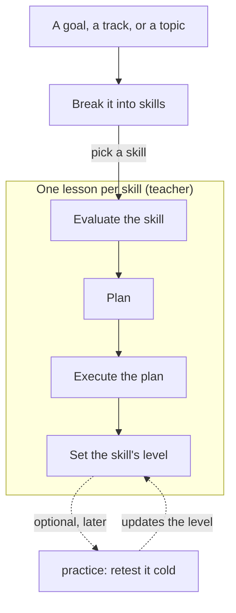

# teach-loop

Three Claude Code skills and one agent that teach, retest and review a learner's sessions in an Obsidian vault. Each lesson and each set of practice problems is a Markdown note in the vault, and `debrief` adds a line to `friction-log.md` (no note), so the learner's progress lives in files they own.

## The loop

A goal, a track or a topic is broken into skills (called strands in `levels.md`, to keep them apart from Claude Code skills). There is one lesson per skill (one strand in the files). The learner picks which skill to learn next ("teach me <skill>"). A single skill can also be taught directly, with no track around it. A lesson runs Orient, Probe (evaluate), Agree (plan), Build (execute) and Seal (set the level; the completed units are recorded in the queue as suggested retests). `practice` and `debrief` are optional and run when the learner asks: `practice` retests what the learner chooses, or what the queue suggests; `debrief` is offered at the end of a session, logs it, and may propose one change to a skill, applied only with the learner's agreement. `researcher` checks claims.

## What each piece does

**teacher** runs on an explicit request ("teach me X", "continue X", or a start such as "my goal is ..." or "I want to learn ..."). Given a goal, track or topic, it breaks it into strands, adds them to `levels.md` and writes a track page in `tracks/`; it does not probe at that point. Given a strand, it reads `LEARNER.md` and the vault, then probes that one strand with explain and predict questions, stopping at the first miss; a lesson covers exactly one strand, and a standalone "teach me X" that needs several is first offered a break into strands; the result is the learner's *edge*. It drafts a plan of units, each framed as a why-question, has the claims checked by `researcher`, and teaches nothing until the learner says yes. Each unit is an Attempt (the learner tries first), an Explain, and a Check whose answer, reasoning and confidence are heard before the verdict. When the evidence contradicts the plan, the plan is edited in a dated callout. At Seal the learner writes their own summary, the strand's level in `levels.md` is updated and the queue gains one row per unit as a suggested retest.

**practice** is optional and runs only on request. It retests old material without a lesson around it. It takes the topic or strand the learner names, or else the rows of `.keys/queue.md` whose suggested date has passed (the oldest rows if none have), mixes strands, and writes each problem in a new setting that does not name the idea it needs. The key is written and verified before the problem is posed. Help comes one rung at a time, starting at the least. A miss gets a short correction, an agreed miss type and a retest in a new form. `practice` moves a level only on evidence from a cold item.

**debrief** ends a session. It checks that the vault can be resumed, counts the session's result lines, asks the learner two fixed questions (pace, and the least clear point), and appends one line to `friction-log.md`. It repairs the vault's resume fields itself, and proposes at most one edit to one skill file, only when the log shows a pattern and only with the learner's agreement. A change on trial is judged after three sessions against the three before.

**researcher** is an agent that checks numbered claims against standards, versioned official docs, primary papers and maintainer writing. For each claim it returns `holds`, `holds-if`, `wrong` or `unverified`, the conditions under which it fails, corrected wording, and sources it opened in that run, each with a quoted sentence.

## Levels

Five levels, `L0` unseen to `L4` knows limits, defined in `levels.md`. A level moves only on evidence, never on self-report.

## Setup

1. Clone this repository.
2. Fill in `LEARNER.md`. `teacher` and `practice` read it at the start of every session.
3. Open the folder as a vault in Obsidian.
4. Run `claude` inside the folder.
5. Say "my goal is ..." or "I want to learn ..." to break it into strands, or "teach me ..." followed by one thing to learn.

Later: "continue ..." resumes a lesson, "practice" optionally retests what you choose, "debrief" ends either.

## What's in the repo

| Piece | Path | Files | Runs when |
|---|---|---|---|
| `teacher` skill | `.claude/skills/teacher/` | `SKILL.md`, `conventions.md`, `questions.md`, `note-template.md` | "my goal is ...", "I want to learn ...", "teach me X", "lesson on X", "continue X" |
| `practice` skill | `.claude/skills/practice/` | `SKILL.md`, `problems.md`, `note-template.md` | "practice", "recall", "test me cold" (optional, on request) |
| `debrief` skill | `.claude/skills/debrief/` | `SKILL.md`, `metrics.md` | "debrief", or offered at the end of a lesson or practice session |
| `researcher` agent | `.claude/agents/researcher.md` | one file | called by `teacher` and `practice`, never by the learner |

`teacher/conventions.md` holds the formats the skills share, including how math, code and diagrams are written so that a stock Obsidian vault renders them; the friction-log line format lives in `friction-log.md`.

## What's in the vault

| Path | Purpose |
|---|---|
| `LEARNER.md` | Who the learner is and how they learn; read by `teacher` and `practice` at the start of each session |
| `index.md` | Entry point and the phrases that start each skill |
| `levels.md` | Level definitions, one row per strand with its edge, dated history |
| `friction-log.md` | One line per session, the change currently on trial, trial history |
| `tracks/` | Track pages: a goal, track or topic broken into strands, with links to its lessons |
| `subjects/` | Lesson notes, `subjects/<subject>/<topic>.md` |
| `practice/` | Practice notes, `practice/<YYYY-MM-DD>-<slug>.md` |
| `.keys/` | Answer keys written before each item is posed (`lessons/`, `practice/`), and `queue.md`, the record of retests with a suggested date |
| `attachments/` | Diagrams and charts embedded in notes |
| `.claude/` | The three skills (`teacher`, `practice`, `debrief`) and the `researcher` agent |

`.keys/` is a dot-folder, which Obsidian hides from the file pane, so neither the answers nor the queue (which names each idea) show before practice.

## Limits

- Claude Code and Obsidian only.
- Fact-checking can still miss: `researcher` reports `unverified` when it cannot open a source, and a source can be wrong.
- The measures come from a few items per session. One session is a sample, not a trend.
- No course content ships; the vault starts empty.

## Credit

*Ideas drawn from amosblomqvist's [learn](https://github.com/amosblomqvist/learn) and [LearnHarness](https://github.com/amosblomqvist/learnharness); no text from either is included.*

## Licence

MIT. See `LICENSE`.
